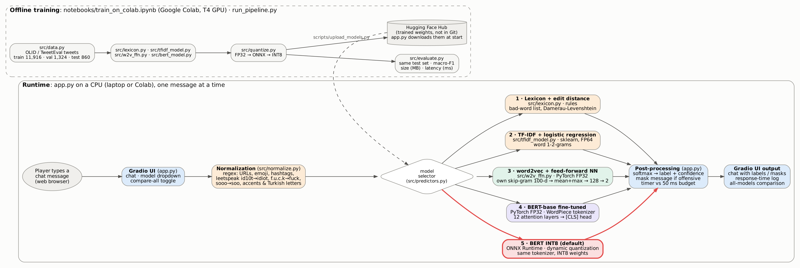

# Real-Time Chat Moderation (SWE015, Use Case 4)

**Author:** Ghaith Azizieh Nweiam · Student ID 2309115497 · SWE015 Introduction to LLMs

A chat app that labels every message **live** as *clean* or *offensive* on a **CPU**, masks offensive messages, and logs the response time of every message against a **50 ms latency budget**. It compares a model ladder trained on the same data and tested on the same held-out test set:

| # | Model | Area | Runs in |
|---|---|---|---|
| 1 | Lexicon + minimum edit distance (rule baseline) | B | Python |
| 2 | TF-IDF + logistic regression (classical baseline) | B | scikit-learn |
| 3 | Our own word2vec + feed-forward network trained with SGD | A (+B) | PyTorch FP32 |
| 4 | BERT-base fine-tuned | C | PyTorch FP32 |
| 5 | **BERT quantized to INT8, used by the app by default** | D | ONNX Runtime INT8 |
| 5b | BERT INT8 with PyTorch dynamic quantization (extra row) | D | PyTorch INT8 |

- **Demo video:** [youtu.be/PtUz7wMfKL0](https://youtu.be/PtUz7wMfKL0)
- **Slides (PDF):** [docs/SWE015_Chat_Moderation.pdf](docs/SWE015_Chat_Moderation.pdf)
- **Trained weights:** [huggingface.co/ghaithpph/chat.moderation.models](https://huggingface.co/ghaithpph/chat.moderation.models)



---

## Quick start: run the app (CPU only)

Python 3.10-3.14. Tested with a clean install on Windows 11 (Python 3.14) and on Linux (Python 3.13).

```bash
git clone https://github.com/ghaithpph1/chat-moderation.git
cd chat-moderation
python -m venv .venv
source .venv/bin/activate          # Windows (cmd): .venv\Scripts\activate
pip install -r requirements.txt
python app.py
```

Open http://127.0.0.1:7860. On the first start, `app.py` downloads the trained weights (19 files, about 740 MB) from the Hugging Face Hub repository set in `MODEL_REPO` in `config.py`; later starts use the local copy. Add `--share` for a public link.

- scikit-learn may print `InconsistentVersionWarning` while loading the TF-IDF model: it was saved with scikit-learn 1.6.1 on Colab. The warning is harmless; the model loads and runs.
- If you download the repository as a ZIP instead of `git clone`, Windows extracts it into a nested folder (`chat-moderation-main\chat-moderation-main`): run the commands inside the inner folder.

### Using the app

- Type a chat message: it is labeled *clean* / *offensive* with a confidence score, and offensive messages are masked (a moderator can reveal the original).
- The side panel logs the response time of every message against the 50 ms budget. The dropdown switches between all six models; the default is **BERT INT8 (ONNX Runtime)**.
- "Also run every model" shows all models' predictions and latencies side by side for the last message.

## Reproduce the training (Google Colab, T4 GPU)

Open `notebooks/train_on_colab.ipynb` in Colab (*Runtime → Change runtime type → T4 GPU*) and run all the cells. It takes about 20-30 minutes. Or, on any machine:

```bash
pip install -r requirements-train.txt
python run_pipeline.py          # data → lexicon → tfidf → w2v_ffn → bert → quantize → evaluate
python scripts/plot_training_curves.py
python scripts/upload_models.py --repo ghaithpph/chat.moderation.models
```

Each step can also be run on its own: `python -m src.data`, `python -m src.lexicon`, `python -m src.tfidf_model`, `python -m src.w2v_ffn`, `python -m src.bert_model`, `python -m src.quantize`, `python -m src.evaluate`.

To check that the code runs end to end without downloading anything (synthetic data and a tiny BERT, about 1 minute): `python tests/smoke_test.py`.

## Results

`python -m src.evaluate` writes `results/results.md`, with macro-F1, size (MB) and latency (ms, mean ± std over 200 single-message runs after 10 warm-up runs, CPU, hardware stated) for every model on the same OLID test set.

| Model | Area | Precision | Macro-F1 | Accuracy | Size (MB) | Latency (ms) mean ± std | p95 (ms) | ≤ budget |
|---|:-:|:-:|:-:|:-:|--:|--:|--:|:-:|
| Lexicon + edit distance (rule) | B | rules | 0.677 | 0.774 | 0.04 | 0.18 ± 0.10 | 0.37 | ✅ |
| TF-IDF + logistic regression | B | FP64 | 0.728 | 0.771 | 0.94 | 0.98 ± 0.15 | 1.22 | ✅ |
| Word2Vec + feed-forward NN | A | FP32 | 0.650 | 0.690 | 3.48 | 0.57 ± 0.21 | 0.87 | ✅ |
| BERT-base fine-tuned (FP32) | C | FP32 | 0.808 | 0.844 | 417.7 | 136.15 ± 31.71 | 194.71 | ❌ |
| BERT INT8 (ONNX Runtime) | D | INT8 | 0.786 | 0.843 | 105.2 | 53.90 ± 24.33 | 97.27 | ❌ |
| BERT INT8 (PyTorch dynamic) | D | INT8 | 0.767 | 0.837 | 173.1 | 62.83 ± 25.09 | 105.35 | ❌ |

Test set: 860 messages (OLID test split). Latency: batch size 1, CPU only, 10 warm-up + 200 timed runs on Intel(R) Xeon(R) CPU @ 2.00GHz (2 logical cores), PyTorch 2.14.1+cu130, ONNX Runtime 1.32.0. Latency budget: 50 ms per message.


**Key findings**

- **BERT-base FP32** has the best quality (0.808 macro-F1) but is the largest and slowest model (417.7 MB, 136.15 ms per message).
- **BERT INT8 (ONNX Runtime)** is 3.97× smaller (417.7 → 105.2 MB) and 2.53× faster (136.15 → 53.90 ms) while keeping 97.3% of the FP32 macro-F1 (0.786 vs 0.808). On the 2-core Colab CPU above it is just over the 50 ms budget; in live app tests on my laptop CPU it answered in about 19-43 ms per message.
- **TF-IDF + logistic regression** (0.728) beats the rule lexicon (0.677) and the Word2Vec + FFN trained on limited data (0.650), all three in under 1 ms.
- Failure examples and limitations: slide 10 and `results/errors_bert_int8_onnx.csv`.

Other outputs in `results/`: `classification_reports.txt`, `predictions_test.csv`, `errors_<model>.csv` (misclassified messages, most confident first), `hardware.txt`, `train_history_*.csv`, `training_curves.png`.

## Homework requirements: where to find them

| Requirement | Where |
|---|---|
| R1 Working application (new input, live result) | `app.py` (Gradio); see *Quick start* |
| R2 Techniques from areas A-D + technique map | slide 5, `docs/technique_map.md` |
| R3 Model ladder on the same held-out test set | `src/evaluate.py`; slide 8 (860 OLID test messages) |
| R4 Results table: metric, size, latency (≥ 100 runs, hardware) | *Results* above, `results/results.md`, slide 8 |
| R5 App runs the quantized Transformer | `app.py` default model: BERT INT8 (ONNX Runtime) |
| R6 Architecture diagram matching the code | `docs/architecture.png`, slide 4 |
| R7 Repository: README, one run command, requirements, no weights in Git | this README, `requirements.txt`, weights on the Hugging Face Hub |
| R8 AI usage statement | slide 11 and *AI usage* below |

## Project structure

```
app.py                     Gradio chat app (runs the quantized model by default)
config.py                  all paths and hyper-parameters
run_pipeline.py            runs every training/evaluation step in order
src/data.py                download OLID (TweetEval) → data/{train,validation,test}.csv
src/normalize.py           regex normalization + tokenizer (shared by every model)
src/lexicon.py             Model 1: lexicon + Damerau-Levenshtein edit distance
src/tfidf_model.py         Model 2: TF-IDF + logistic regression
src/w2v_ffn.py             Model 3: own word2vec + feed-forward network (SGD)
src/bert_model.py          Model 4: BERT fine-tuning
src/quantize.py            Model 5: ONNX export + INT8 dynamic quantization
src/predictors.py          one interface for all models (used by evaluate.py and app.py)
src/evaluate.py            results table: macro-F1, size, latency
lexicon/extra_en.txt       hand-added insults for the rule baseline
scripts/                   upload weights to the HF Hub, plot training curves
notebooks/                 Colab notebook that runs the whole pipeline
docs/                      architecture diagram, technique map, slide outline, study guide
tests/smoke_test.py        offline end-to-end test
```

Model weights are **not** in this repository. They are on the Hugging Face Hub (see `MODEL_REPO` in `config.py`).

## Data and sources

- **OLID / OffensEval 2019**: M. Zampieri et al., *Predicting the Type and Target of Offensive Posts in Social Media*, NAACL 2019. Used through **TweetEval**: F. Barbieri et al., *TweetEval: Unified Benchmark and Comparative Evaluation for Tweet Classification*, Findings of EMNLP 2020 (`cardiffnlp/tweet_eval`, config `offensive`). Official train / validation / test splits.
- **Bad-word list**: LDNOOBW, *List of Dirty, Naughty, Obscene, and Otherwise Bad Words* (CC BY 4.0), plus our own `lexicon/extra_en.txt`.
- **BERT**: J. Devlin et al., 2019, `google-bert/bert-base-uncased`.
- **word2vec**: T. Mikolov et al., 2013 (gensim implementation).
- Benchmark and quantization method follow L. Tunstall, L. von Werra & T. Wolf, *Natural Language Processing with Transformers*, Ch. 8.

## AI usage (R8)


| Tool | What it was used for |
|---|---|
| Claude (Anthropic) | Wrote most of the project code: data pipeline, regex normalization, the five models, ONNX INT8 quantization, evaluation and the Gradio app. Also the Colab notebook, this README, the architecture diagram and the slide-deck layout. |
| Gemini (Google) | Helped with scaffolding and slide formatting. |

**My own work**

- Executed all training, ONNX INT8 quantization and CPU latency benchmarks myself on Google Colab and locally.
- Analyzed the model trade-offs and error cases (`results/errors_bert_int8_onnx.csv`) and deployed the trained weights to Hugging Face (`ghaithpph/chat.moderation.models`).
- Reviewed, tested and verified every module end-to-end, including a clean install from this README on Windows.
- Every number in this README and in the slides comes from my own runs (see `results/`).
